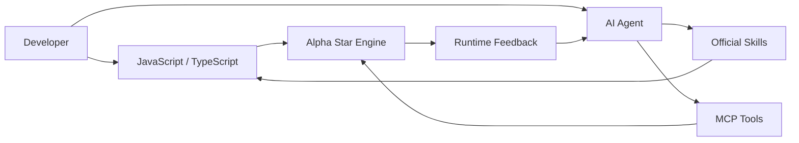
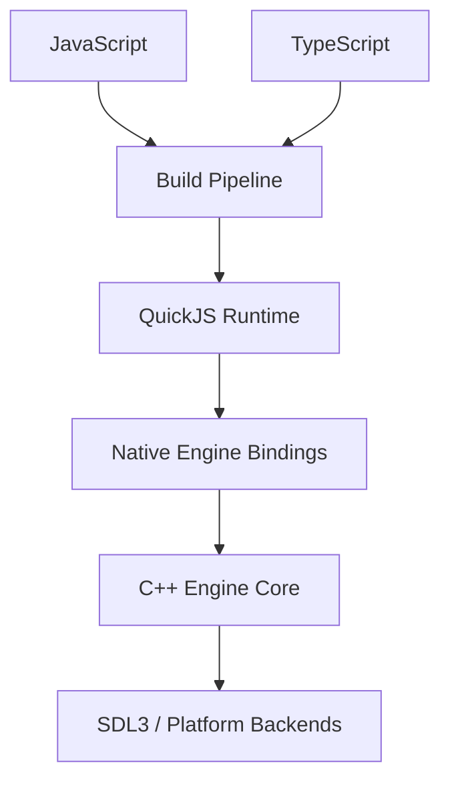

  

# Alpha Star Engine

**Code. Vibe. Ship.**

A native game engine built for developers and designed for AI agents.

Alpha Star is a game engine in development, powered by C++, SDL3 and QuickJS. It is designed to make game development approachable through JavaScript and TypeScript, with first-class support for AI-assisted development and a clear path toward desktop, mobile and console distribution.

Write every line yourself, collaborate with an AI agent, or build through vibe coding. Your game remains your code.

> **Development status:** Alpha Star is under active development. This README describes both its current technical foundation and its intended capabilities. Roadmap features are not yet guaranteed to be available.

## Why Alpha Star?

Alpha Star is not intended to compete with established engines by offering the largest collection of features. Its goal is to reduce the complexity of creating, understanding, testing and shipping games.

- **Simple by design:** predictable APIs, sensible defaults and minimal boilerplate.
- **Native foundation:** C++ and SDL3 for platform integration and performance-critical systems.
- **JavaScript scripting:** an embedded QuickJS runtime, without requiring Node.js on the player's machine.
- **TypeScript workflow:** a planned compilation pipeline and typed engine APIs for better tooling and code completion.
- **AI-native development:** official agent skills and integrated Model Context Protocol (MCP) tools designed specifically for game development.
- **Code-first freedom:** traditional programming and vibe coding use the same engine and gameplay APIs.
- **Cross-platform ambition:** a shared codebase targeting desktop, mobile and authorized console environments.
- **Tool-friendly pipeline:** planned first-class integration with established tools such as LDtk rather than reinventing every content creation workflow.

## AI-native, not AI-dependent

AI is a development capability, not a requirement to use Alpha Star or play a finished game.

Alpha Star aims to give agents such as Codex, Claude Code and other compatible clients the tools and knowledge necessary to work directly with a game project. Official skills explain engine conventions, while MCP tools provide structured operations and feedback.

The intended agent workflow is to inspect the project, implement a feature, run the game, observe its behavior, validate the result and iterate. Agents should use real engine APIs rather than guess at unsupported methods.

### Planned agent capabilities

| Capability | Purpose |
| --- | --- |
| API discovery | Inspect available engine APIs and version-specific documentation. |
| Project inspection | Understand assets, scenes, entities and configuration. |
| Runtime control | Launch, stop and inspect a running game. |
| Visual feedback | Capture screenshots and inspect rendered results. |
| Input simulation | Exercise gameplay through keyboard, mouse, touch or controller input. |
| Diagnostics | Read structured errors, logs and runtime state. |
| Testing and profiling | Validate behavior and identify performance bottlenecks. |
| Level design | Create, edit, preview and validate LDtk maps. |

Skills and tool schemas should be versioned alongside the engine. Development-only tools should remain outside production builds by default.

## JavaScript and TypeScript

JavaScript is the scripting language of Alpha Star. QuickJS executes gameplay scripts inside the native engine, while performance-critical operations can be implemented in C++ and exposed through a consistent scripting API.

The planned TypeScript workflow will compile TypeScript into JavaScript before execution, with type declarations matching the installed engine version.

### Development and distribution

The intended development workflow favors readable source files, fast iteration, debugging and hot reload. Release builds are planned to support precompiled QuickJS bytecode and packaged assets, eliminating the need to ship original JavaScript source files.

Bytecode improves loading by avoiding source parsing and compilation at startup. It is not native machine code, encryption or a guarantee of faster gameplay execution. Bytecode compatibility must be managed alongside the embedded QuickJS version.

## LDtk integration

[LDtk (Level Designer Toolkit)](https://ldtk.io/) is planned as a first-class level design integration for Alpha Star.

Developers should be able to create maps manually in LDtk, ask an AI agent to generate or modify maps, and continue editing the same project visually afterward.

The planned integration includes:

- Importing LDtk worlds, levels, tile layers, tilesets and AutoLayers.
- Mapping IntGrid values to collision and terrain data.
- Instantiating gameplay entities from LDtk entity definitions and custom fields.
- Dedicated level design skills and MCP tools for inspecting tilesets, painting regions, drawing paths, placing entities and generating previews.
- Map validation and navigation checks to help agents detect invalid or inaccessible areas.
- Maintaining valid, editable LDtk projects as the source of truth.

The goal is to let agents perform high-level level design operations without generating thousands of individual tile coordinates or manipulating raw LDtk JSON unnecessarily.

## Target platforms

Alpha Star is designed with portability in mind. The following platforms are intended targets, not a list of currently verified export capabilities.

| Platform | Planned distribution |
| --- | --- |
| Windows | Public engine distribution |
| Linux | Public engine distribution |
| macOS | Public engine distribution |
| Android | Public engine distribution |
| iOS | Public engine distribution |
| Xbox | Restricted platform integration |
| Nintendo Switch | Restricted platform integration |

### Console development

Alpha Star aims to provide authorized developers with access to private console integrations or forks, subject to platform-holder approval and applicable agreements.

The intended model is a shared public-facing gameplay API with restricted platform-specific implementations. Developers should be able to begin with desktop development and transition to supported console platforms without rewriting the entire game.

Console access will depend on SDK availability, platform-holder authorization, applicable NDAs, middleware distribution permissions and certification requirements. Alpha Star cannot grant platform approval on behalf of Microsoft or Nintendo. Confidential SDKs and documentation must not be exposed to AI services without explicit authorization.

## Design principles

| Principle | Engineering direction |
| --- | --- |
| Simplicity | Prefer a small, coherent API over multiple competing abstractions. |
| Predictability | Consistent naming, lifecycle rules and error reporting. |
| Discoverability | Machine-readable APIs, typed declarations and versioned documentation. |
| Observability | Runtime state, logs and visual output accessible to development tools. |
| Performance | Keep expensive systems native and minimize unnecessary JS/C++ boundary crossings. |
| Portability | Abstract platform-specific services behind shared interfaces: every file goes through one SDL_IOStream layer (folders, APK assets, archives), and games pause/resume with the app lifecycle (`ctx.onPause`, `ctx.onResume`, `config.pauseOnFocusLoss`). |
| Ownership | Keep game projects editable and independent of mandatory AI services. |

## Roadmap

The following is a proposed roadmap, not a release schedule.

- [ ] Stabilize the native engine core and JavaScript bindings.
- [ ] Establish the TypeScript build pipeline and generated type declarations.
- [ ] Deliver official skills and integrated MCP development tools.
- [ ] Implement the LDtk import and agent-assisted level design workflow.
- [ ] Add runtime diagnostics, visual feedback, automated gameplay testing and profiling.
- [ ] Implement production packaging and QuickJS bytecode export.
- [ ] Validate desktop export targets.
- [ ] Implement and validate Android and iOS export targets.
- [ ] Pursue authorized Xbox and Nintendo Switch integrations.

## Getting started

Installation instructions, build prerequisites, example projects and API documentation will be published as the engine's development workflow stabilizes.

## Technology

- [C++](https://isocpp.org/) — native engine implementation.
- [SDL3](https://www.libsdl.org/) — cross-platform multimedia and platform abstraction.
- [QuickJS](https://bellard.org/quickjs/) — embedded JavaScript runtime.
- [TypeScript](https://www.typescriptlang.org/) — planned typed scripting workflow.
- [Model Context Protocol](https://modelcontextprotocol.io/) — agent tooling integration.
- [LDtk](https://ldtk.io/) — planned 2D level design integration.

## License

The Alpha Star licensing model has not yet been announced. Third-party components remain subject to their respective licenses. Restricted console integrations will also be subject to applicable platform agreements.

---

**Alpha Star Engine — Code. Vibe. Ship.**

*Less complexity. More creativity.*
