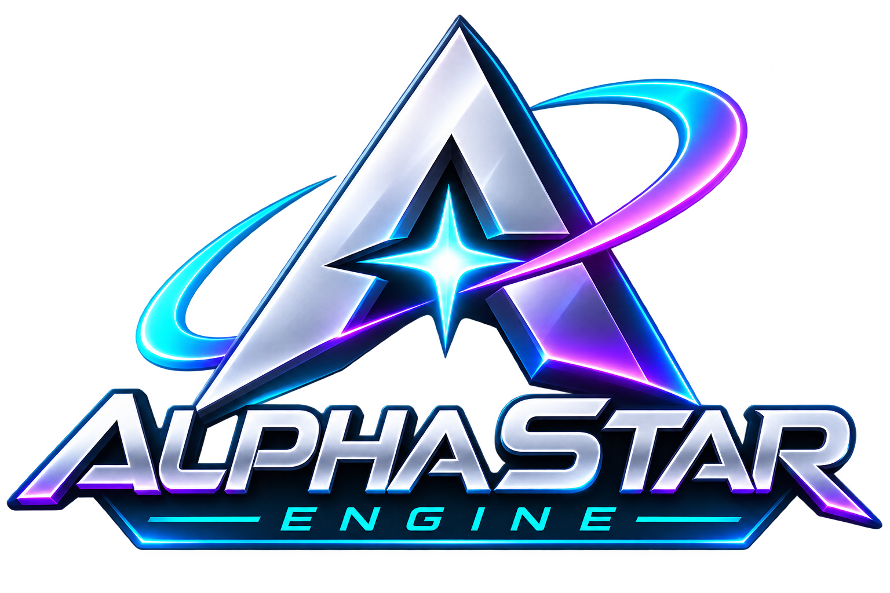

<p align="center">
  
</p>

# Alpha Star Engine

Engine 2D nativa para jogos escritos em TypeScript e JavaScript, com ferramentas para agentes de IA criarem, testarem e inspecionarem o jogo em execução.

O projeto reúne uma engine em **C++20, SDL3, Box2D v3 e QuickJS-ng** e o **`@alpha-star/sdk`**, que fornece a API tipada e a CLI `alpha`. O jogo é definido em código: cenas, entidades, regras e assets. O SDK verifica os tipos e empacota os scripts; a engine executa o resultado sem Node.js na máquina do jogador.

O fluxo para agentes já está implementado: um servidor MCP permite iniciar o jogo, enviar comandos, avançar a simulação, consultar entidades, capturar imagens e ler erros. Também é possível desenvolver manualmente usando a mesma API e CLI, sem serviço de IA obrigatório.

> [!NOTE]
> O repositório está na versão **0.2.0**, em desenvolvimento. As [notas da versão](docs/RELEASE_0.2.0.md) registram a preparação dos pacotes, sem publicação. O início rápido abaixo usa o código local e não depende da disponibilidade do SDK no npm.

## Recursos implementados

| Área | O que existe hoje |
|---|---|
| Gameplay | Cenas com estado e ciclo de vida, entidades por especificações, tags, timers e tweens. Simulação a 60 passos por segundo e gerador aleatório com seed. |
| Renderização 2D | Sprites, sheets e animações, atlas de imagens, câmera, layers, parallax e partículas. |
| Física | Box2D v3: corpos, colisões, sensores, queries, raycasts, joints e plataformas de mão única. |
| Mapas | Importação de mapas JSON do Tiled, tilesets e geração de colisores. |
| Interface e texto | UI de jogo em RmlUi (`.rml`/`.rcss`), navegação por gamepad, fontes TTF/OTF, BMFont e fonte embutida. |
| Entrada | Ações e eixos para teclado, mouse, gamepads e touch; múltiplos jogadores locais, rumble e conexão de controles em execução. |
| Áudio | WAV, OGG e MP3, sons sintetizados, música em streaming, buses de volume e panorâmica estéreo. |
| Persistência | Saves, configurações e localização, incluindo plurais. |
| Efeitos | Bloom, CRT, pixelate, tint, vignette e iluminação 2D. São efeitos predefinidos; não há API de shaders customizados. |
| Desenvolvimento | Hot reload, testes sem janela, MCP e ferramentas F12: inspector, console, pausa, avanço de passos, visualização da física e profiler. |
| Distribuição | Packs de scripts e assets; exportação standalone com engine de jogador e bytecode; geração de projeto Android. |

## Começar pelo repositório

### Preparar a engine no Windows

Requisitos: **Git, Node.js 20+, Python, CMake 3.28+ e Visual Studio com ferramentas C++20**. As dependências nativas são obtidas pelo CMake; a primeira compilação precisa de acesso à rede.

No PowerShell, a partir da pasta onde deseja clonar o projeto:

```powershell
git clone https://github.com/luciancaetano/alpha-star.git
cd alpha-star
$env:CMAKE_BUILD_PARALLEL_LEVEL = "8"
npm --prefix alpha-sdk ci
python tools/stage_engine.py
```

O último comando compila e prepara as engines `release` e `shipping` em `alpha-sdk/engine/`. Ele já limita o uso de recursos. Execute uma compilação por vez.

### Jogar e testar um exemplo

Ainda no checkout, execute o Flappy Orbit:

```powershell
cd examples/flappy
npm install
python ../../tools/resource_guard.py -- node ../../alpha-sdk/bin/alpha.mjs test
python ../../tools/resource_guard.py -- node ../../alpha-sdk/bin/alpha.mjs run --watch
```

`test` executa os testes do jogo sem janela. `run --watch` abre o jogo e atualiza o pack quando o código muda. Pressione **F12** ou **Back+Start** no gamepad para abrir as ferramentas de desenvolvimento.

Os comandos acima usam `resource_guard.py` para limitar CPU e memória dos processos. Use essa proteção também para builds, testes e benchmarks executados manualmente neste repositório.

### Criar seu próprio jogo

A partir da raiz do checkout, crie uma pasta irmã usando o SDK local:

```powershell
$sdk = (Resolve-Path alpha-sdk).Path.Replace('\', '/')
node alpha-sdk/bin/alpha.mjs init ../meu-jogo --template platformer --sdk "file:$sdk"
cd ../meu-jogo
npm install
npm run check
```

Templates disponíveis: **`blank`, `platformer`, `topdown`, `puzzle` e `shmup`**. Eles incluem código, assets de exemplo, testes e um `AGENTS.md` com orientações para trabalhar no jogo. A dependência `file:` mantém o novo projeto ligado a este checkout do SDK.

Na pasta de um jogo com o SDK instalado:

| Comando | Resultado |
|---|---|
| `npx alpha check` | Verifica os tipos do jogo. |
| `npx alpha test` | Executa os testes com `simulate` e `expect`. |
| `npx alpha run --watch` | Empacota, abre o jogo e acompanha alterações. |
| `npx alpha export` | Gera um pack em `dist/`, com `main.js` e assets. |
| `npx alpha export --standalone --out build/game` | Gera uma pasta para distribuição com a engine shipping e `game.jsbc`. |
| `npx alpha mcp` | Inicia o servidor MCP por stdio. |

## Como um jogo é organizado

O ponto de entrada é `src/main.ts`, que exporta a definição do jogo: configuração, cena inicial, cenas e assets. Os templates dividem esse código em partes pequenas:

```text
src/
  types.ts       nomes de ações, tags, cenas e assets usados pela API
  alpha.ts       scene e game especializados com os tipos do jogo
  tuning.ts      valores de velocidade, duração e outros ajustes
  prefabs/       funções que produzem especificações de entidades
  scenes/        comportamento e estado de cada cena
  main.ts        configuração e composição do jogo
assets/          imagens, áudio, fontes, mapas e UI
test/            testes do jogo
```

Cada cena tem os hooks `state`, `enter`, `update` e `exit`. O contexto `ctx` oferece operações como `spawn`, `find`, `input`, `audio`, `ui`, `camera` e `go`. Entidades são criadas a partir de dados; um `body` adiciona física e um `emitter` adiciona partículas. Entidades, handlers, timers e tweens pertencem à cena e são removidos na troca de cena.

O passo fixo e `ctx.random`, controlado pela seed do jogo, permitem reproduzir cenários com os mesmos inputs nos testes. Erros de script pausam a execução e são reportados com diagnóstico; durante o desenvolvimento, source maps apontam para o TypeScript original.

Leia [Conceitos](docs/guide/concepts.md), [Testes](docs/guide/testing.md) e a [API tipada](alpha-sdk/types/alpha.d.ts) para os contratos completos.

## Trabalhar com agentes de IA

Configure o cliente MCP para executar `npx alpha mcp` com a **pasta do jogo como diretório de trabalho**. Um ciclo de desenvolvimento pode usar:

1. `alpha_check` e `alpha_test` para verificar a alteração.
2. `game_start` para abrir o jogo, com ou sem janela visível.
3. `game_input` e `game_step` para exercitar um cenário.
4. `game_state`, `game_screenshot` e `game_logs` para observar o resultado.
5. `game_reload` para carregar a próxima alteração.

O canal de controle da engine é local, com token por execução, e não está presente na build shipping. Veja a [configuração MCP e lista de ferramentas](docs/guide/mcp.md) e o [guia para agentes](docs/guide/agents.md).

## Exemplos para estudar

| Jogo | Demonstra |
|---|---|
| [Flappy Orbit](examples/flappy) | Cenas de menu e jogo, UI, música, configurações, localização e recorde salvo. |
| [Platformer](examples/platformer) | Sprite sheets, mapa Tiled, câmera, plataformas, colisões e partículas. |
| [Topdown](examples/topdown) | Dois jogadores, mira automática, queries de física, rumble e iluminação. |
| [Puzzle](examples/puzzle) | Sokoban com regras puras, desfazer jogadas, progresso salvo e opções de acessibilidade. |
| [Shmup](examples/shmup) | Categorias de colisão, movimento em lote, parallax, bloom e CRT. |

Todos possuem testes. Flappy é um exemplo do repositório; os outros quatro também são templates de `alpha init`.

## Exportação e plataformas

Um **pack** é a pasta que a engine executa. A exportação comum contém JavaScript e assets declarados. Com `--standalone`, o SDK inclui a engine de jogador e compila o jogo para **`game.jsbc`**, vinculado à versão/build da engine. O jogador abre o executável dessa pasta; não precisa instalar o SDK ou Node.js. O bytecode não é criptografia e os arquivos do pack devem vir de uma fonte confiável.

| Plataforma | Situação documentada nesta versão |
|---|---|
| Windows x64 | Builds release/shipping e fluxo de exportação standalone validados localmente. |
| Linux x64 | Alvo e pacote de engine implementados; gate e preparação da release devem ser executados na máquina Linux dedicada. |
| Android arm64 | Exportador gera projeto Gradle com assets e bytecode; build do APK e execução em dispositivo ainda não validados nas notas da versão. |
| macOS | Build experimental no CI; sem pacote de engine ou distribuição `.app` validados. |
| iOS e consoles | Sem fluxo de exportação implementado documentado nesta versão. |

A exportação Android usa `alpha export --target android-arm64` e exige a toolchain Android para compilar o APK. Assinatura desktop via `--sign` depende de um comando externo configurado em `ALPHA_SIGN_CMD`.

Consulte [Exportação](docs/guide/exporting.md), [Android](docs/guide/android.md) e as [limitações da versão](docs/RELEASE_0.2.0.md#known-limitations). A integração de mapas existente é com **Tiled**; LDtk não é uma integração entregue. Os efeitos visuais atuais atuam sobre o mundo, não sobre a UI RmlUi.

## Desenvolver a engine

| Diretório | Responsabilidade |
|---|---|
| `src/` | Engine C++: core, ECS, física, renderização, plataforma, scripts, UI, devtools e MCP. |
| `alpha-sdk/` | CLI, tipos TypeScript, templates, exportadores e testes do SDK. |
| `examples/` | Cinco jogos completos usados como referência. |
| `tests/` | Testes C++ organizados por módulo. |
| `docs/guide/` | Fontes dos guias; `docs/site/` contém o site gerado. |
| `tools/` | Build, validação, cobertura, benchmarks e empacotamento. |
| `cmake/` | Dependências, opções de compilação e flavors. |

As builds têm finalidades diferentes:

| Preset | Uso |
|---|---|
| `dev` | Desenvolvimento da engine, testes e cobertura. |
| `harness` | Validação rápida do core, sem dependências do runtime; não substitui o gate completo. |
| `release` | Engine otimizada usada por `alpha run`, `alpha test` e `alpha mcp`, com ferramentas de desenvolvimento. |
| `shipping` | Engine para jogadores, sem devtools, MCP ou runner de testes, com LTO e símbolos removidos. |

Na raiz do repositório:

```powershell
$env:CMAKE_BUILD_PARALLEL_LEVEL = "8"
python -m pip install -r tools/requirements.txt
python tools/gate.py
```

O gate protegido executa configuração, build, testes, cobertura e verificações de limites, acesso a arquivos, CRAP e duplicação. No Windows, a coleta de cobertura também requer `Microsoft.CodeCoverage.Console`; veja [as instruções de cobertura](tools/coverage.py). As regras completas estão em [AGENTS.md](AGENTS.md) e [CONTRIBUTING.md](CONTRIBUTING.md).

Para gerar a documentação, execute `npm --prefix alpha-sdk run docs` e abra `docs/site/index.html`. A referência da API é gerada a partir de `alpha-sdk/types/alpha.d.ts`. Para preparar e testar os pacotes de release localmente, use `python tools/pack_release.py --install-test`; esse comando não publica os pacotes.
